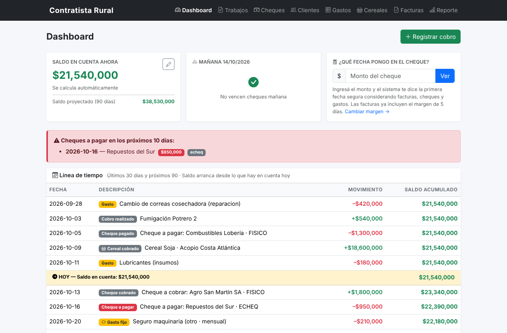
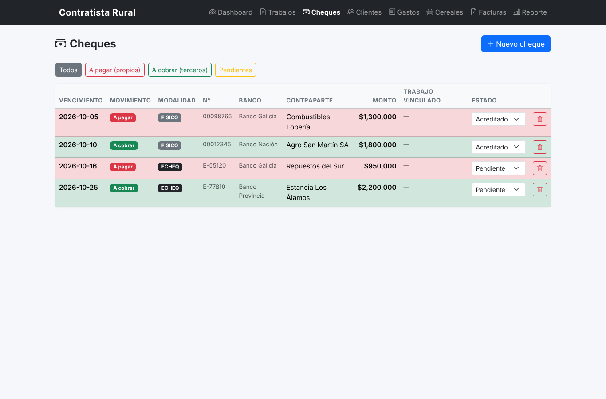
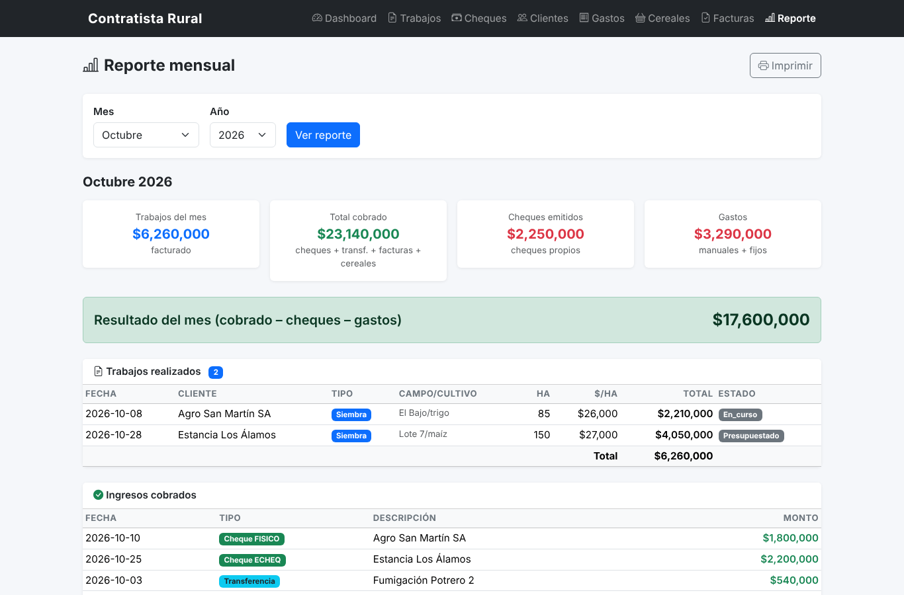

# sitadmin — Contractor Administration System

A custom administrative web application built for a contracting business (real client, in active daily use in production). Manages clients, jobs, expenses, invoices, cereal sales and a full check lifecycle.




| Cheques | Monthly report |
|---|---|
|  |  |

*Screenshots use fictional demo data (`seed_demo.py`).*

## Tech Stack

- **Backend:** Python 3 · Flask 3
- **Database:** SQLite (single-file)
- **Templates:** Jinja2
- **Frontend:** HTML, CSS

## Features

### Core entities (10-table relational schema)

- `clientes` — clients
- `trabajos` — jobs / works performed
- `gastos` — expenses (linked optionally to a check)
- `gastos_recurrentes` — recurring expenses (weekly / fortnightly / monthly)
- `cobros` — payments received
- `cheques` — check movements (own emitted **and** third-party received) with status lifecycle: `emitido → depositado → acreditado`
- `facturas` — invoices
- `ventas_cereales` — cereal sales (tons × price/ton)
- `config` — runtime configuration (e.g. initial balance, payment-window in business days)

### Business logic highlights

- **Real-time balance projection** — `calcular_saldo_actual()` aggregates payments, deposited checks, expenses, cereal sales and invoices to compute the cash position for the day
- **Recurring expense forecasting** — `proyectar_recurrentes(inicio, limite)` walks through monthly / fortnightly / weekly schedules to project upcoming expenses across a date range
- **Business-day arithmetic** — `sumar_dias_habiles(fecha, dias)` skips weekends to estimate when a payment will land
- **Check lifecycle modeling** — own checks reduce the balance only once they're deposited or credited; third-party checks add to the balance only on credit date — preventing double-counting

## Project structure

```
.
├── app.py              # Flask app, routes and business logic (~840 lines)
├── database.py         # Schema bootstrap, connection helper (~155 lines)
├── seed_demo.py        # Loads fictional demo data
├── requirements.txt    # Flask
├── requirements-dev.txt # + pytest
├── tests/              # pytest suite (business logic + routes)
├── docs/screenshots/   # README images
├── .github/workflows/  # CI: runs the tests on every push
└── templates/          # 10 Jinja2 templates
    ├── base.html
    ├── index.html
    ├── clientes.html
    ├── trabajos.html
    ├── gastos.html
    ├── cheques.html
    ├── facturas.html
    ├── cereales.html
    ├── remito.html
    └── reporte.html
```

## Running locally

```bash
# 1. Clone and enter the project
git clone https://github.com/<your-username>/sitadmin.git
cd sitadmin

# 2. Set up a virtualenv
python3 -m venv venv
source venv/bin/activate

# 3. Install dependencies
pip install -r requirements.txt

# 4. Run
python3 app.py
# Open http://localhost:5050
```

The SQLite schema is created automatically on first run via `init_db()`.

## Demo data

To try the app without real data, load a set of fictional clients, jobs, cheques and invoices into a separate database:

```bash
SITADMIN_DB=demo.db python3 seed_demo.py
SITADMIN_DB=demo.db python3 app.py
```

`SITADMIN_DB` sets the SQLite file to use (default: `contratista.db`). Database files are git-ignored, so real business data never ends up in the repository. Set `FLASK_DEBUG=1` to run with the debugger and auto-reload.

## Tests

The business logic is covered by a pytest suite that runs on every push via GitHub Actions:

```bash
pip install -r requirements-dev.txt
pytest -v
```

- `tests/test_logica.py`: business-day arithmetic, balance calculation (including the cheque/expense no-double-counting rule), recurring expense projection (month ends, year rollover, fortnightly and weekly schedules) and the "first safe date" cheque calculator.
- `tests/test_rutas.py`: every page renders, and the main forms (clients, invoices, cheque status, recurring expenses) write the right data.

Each test runs against its own temporary database.

## What I learned building this

- Designing a 10-table relational schema for a non-trivial financial domain
- Implementing a state machine for check lifecycle (`emitido / recibido_tercero / depositado / acreditado`)
- Modelling cash flow with multiple parallel sources (payments, checks, cereal sales, invoices)
- Building forecasting logic that walks recurring schedules across arbitrary date ranges
- Skipping weekends with custom business-day arithmetic
- Shipping a system to a real, non-technical user and supporting it in production
- Writing automated tests for financial logic and running them in CI

## Author

Valentín Santamaría — final-year Software Development student, based in Dublin.
[LinkedIn](https://www.linkedin.com/in/valentin-santamaria-dev)
